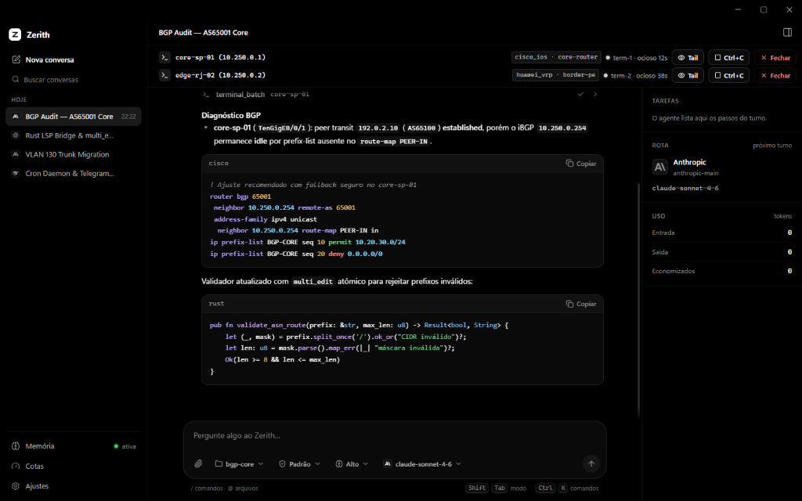
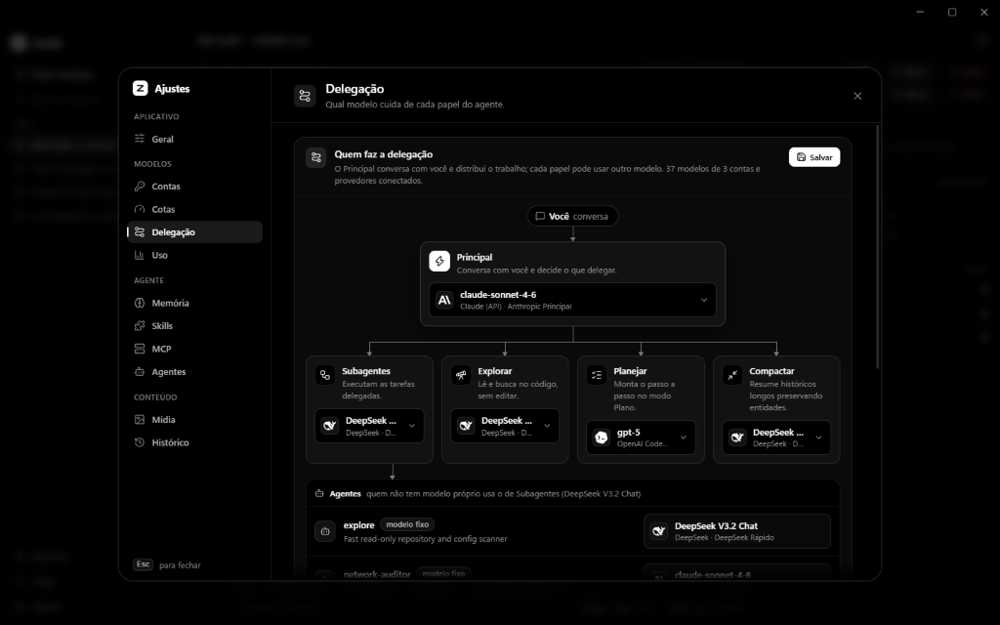
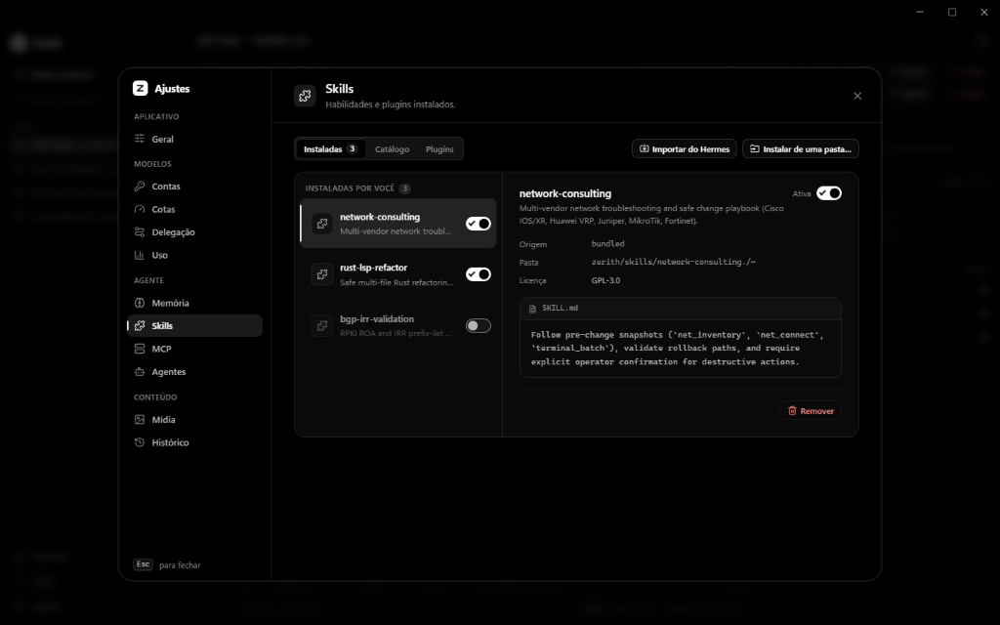
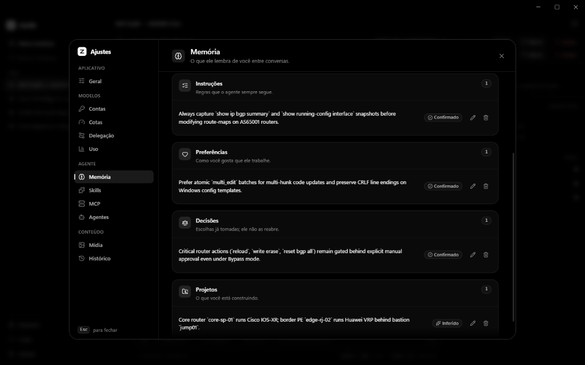

<div align="center">
  <picture>
    <source media="(prefers-color-scheme: dark)" srcset="crates/zerith-desktop/icons/logo-white.svg" />
    <source media="(prefers-color-scheme: light)" srcset="crates/zerith-desktop/icons/logo-black.svg" />
    
  </picture>

  <h1>Zerith</h1>
  <p>
    <strong>Native Rust AI agent harness &amp; Tauri 2 desktop workbench</strong><br />
    Built for heavy software engineering, multi-vendor network consulting, and autonomous CLI/daemon workflows.
  </p>

  <p>
    <a href="https://github.com/Mistertelecom/zerith/releases">
      
    </a>
    <a href="https://github.com/Mistertelecom/zerith/actions/workflows/zerith.yml">
      
    </a>
    
    
    <a href="LICENSE">
      
    </a>
  </p>
</div>

---

Zerith is an original, self-contained AI agent harness written in **Rust** across **13 workspace crates**, paired with a **Tauri 2 + React/TypeScript** desktop app (`zerith-desktop`) and a fast single-binary CLI (`zerith`).

It combines human-in-the-loop tool governance, a native multi-account LLM gateway, semantic LSP & worktree coding tools, interactive SSH/PTY network device automation, cron scheduling, local FTS5 memory, and a fail-closed Telegram gateway—with zero external Node/Python runtime daemons required.

---

## Screenshots

<table>
  <tr>
    <td width="50%" valign="top">
      <strong>Workspace Chat, Active SSH Terminals &amp; Syntax Highlighting</strong><br />
      <sub>Multi-vendor network CLI &amp; Rust highlighting, live PTY strips, tool previews, reasoning effort selector, and session context controls.</sub>
      <br /><br />
      
    </td>
    <td width="50%" valign="top">
      <strong>Multi-Model Delegation &amp; Routing Tree</strong><br />
      <sub>Assign separate models/accounts for Main, Subagents, Explore, Plan, and Smart Compaction roles plus multi-model failover combos.</sub>
      <br /><br />
      
    </td>
  </tr>
  <tr>
    <td width="50%" valign="top">
      <strong>Skills, Plugins &amp; Hermes Importer</strong><br />
      <sub>Review-before-run Agent Skills inspector with static security findings, toggle controls, GitHub catalog, and Hermes migration.</sub>
      <br /><br />
      
    </td>
    <td width="50%" valign="top">
      <strong>Scoped Persistent Memory (SQLite FTS5)</strong><br />
      <sub>Project- and user-scoped instructions, preferences, decisions, and inferred facts ranked with BM25 + recency scoring.</sub>
      <br /><br />
      
    </td>
  </tr>
</table>

---

## What's Inside (v0.2.3)

### 1. Speed, Prompt Caching & Native Gateway
- **Native Multi-Account LLM Gateway (`zerith-providers`):** Direct support for OpenAI, Anthropic, Codex (OAuth), Antigravity (OAuth), DeepSeek, Gemini, OpenRouter, Ollama, LM Studio, and custom OpenAI/Anthropic endpoints—with per-account quotas, cooldowns, combos, and automatic failover.
- **Prompt Caching & Token Saver (`zerith-runtime`):** Provider prompt-cache optimization, deterministic `Ponytail` / `Caveman` / `RTK` output filters, and dynamic `compact_model` routing with automatic 70% background pre-compaction.
- **Zero Cold-Start Warm Caches:** Pre-warmed, generation-invalidated `McpCache` registries and SQLite schema caching.

### 2. Desktop Workbench & Interactive CLI
- **Desktop App (`zerith-desktop`):** Non-blocking background turn runner, Ed25519-signed auto-updater (`update.rs`), live command palette (`Ctrl+K` / `Cmd+K`), `Shift+Tab` mode cycling, `ArrowUp` prompt recall, context window gauge, and diff review with per-turn file `undo`.
- **Live Turn Control:** Real-time mid-turn steering (`steer_turn`), throttled `ToolProgress` output streaming, end-to-end `reasoning_effort` (`off` / `low` / `medium` / `high`), and session-scoped approval grants with safe command-prefix matching.
- **Zero-Dependency Syntax Highlighter:** Pure TypeScript tokenizer highlighting Rust, TypeScript/JavaScript, Python, Shell, JSON, TOML, YAML, SQL, and multi-vendor Network CLIs (Cisco IOS/XR/NX-OS, Huawei VRP, Juniper Junos, MikroTik RouterOS, Fortinet FortiOS, FRR) with IP/CIDR, interface, `permit`/`established`, and `deny`/`shutdown` color tokens.
- **Interactive CLI REPL (`zerith repl`):** Multi-turn terminal session retaining warm HTTP clients, MCP tools, session grants, and slash commands (`/help`, `/model`, `/mode`, `/effort`, `/compact`, `/rewind`, `/sessions`, `/clear`, `/exit`).

### 3. Heavy Software Engineering Toolkit
- **Fast Search (`glob`, `grep`, `ripgrep` fast-path):** Root and nested `.gitignore` filtering, `-A`/`-B`/`-C` context lines, `case_insensitive` toggles, `rg --sort path` acceleration when present, and multi-threaded Rust fallback.
- **Atomic Batch Editing (`multi_edit`):** All-or-nothing transactional multi-hunk edits with automatic rollback on failure, CRLF preservation, unique normalized-whitespace matching fallback, ambiguity refusal, and legacy Latin-1 round-trip support.
- **Stdio LSP Bridge (`lsp.rs`):** Native `lsp_diagnostics`, `lsp_definition`, `lsp_references`, and `lsp_symbols` across Rust, TypeScript/JavaScript, Python, Go, and C/C++.
- **Git Worktree Isolation & Rewind:** Subagents can run isolated via `WorktreeGuard` (`git worktree`), automatically cleaning up untouched worktrees or preserving dirty ones with a `git diff --stat` report; file + conversation checkpoints restore via `zerith rewind`.
- **Remote Targets (`--remote` & `zerith remote`):** Run sessions and `remote_shell` against `ssh://` hosts or `docker://` containers with configured aliases in `[remote.targets]` and POSIX shell/flag-injection hardening.

### 4. Network Consulting Suite
- **Interactive PTY Terminals (`terminal.rs`):** ConPTY/PTY sessions with tail checks, automatic pager handling (`auto_page` for `--More--` / `---- More ----`), interruptible `Ctrl+C` (`0x03`), and the Desktop **Active Terminals** strip (`Tail`, `Ctrl+C`, `Close`).
- **Device Inventory & Bastion SSH (`network.rs`):** Merge global and workspace `.zerith/inventory.toml` inventories with OS-keyring credentials, `net_inventory`, `net_connect` (auto disable-paging, `jump_host`, `legacy_ssh`), and multi-command `terminal_batch`.
- **Risk Classification & Red-Flag Safety:** Automatic platform-aware classification (`ReadOnly` / `Mutation` / `Dangerous`) in `pipeline.rs` forcing explicit confirmation on destructive router/switch operations (`reload`, `write erase`, `reset bgp`, etc.) even under `Bypass` mode, alongside expanded `READ_ONLY` shell network diagnostics and RTK `network-config`/`network-table` compression.
- **Bundled Skill:** Ships with [`bundled-skills/network-consulting/SKILL.md`](bundled-skills/network-consulting/SKILL.md).

### 5. Autonomy, Memory & Messaging
- **Unified SQLite Store (`zerith-sessions` & `zerith-memory`):** Single transactional SQLite file with `V1–V10` schema migrations, `session_search` across past chats, and FTS5 recall combining BM25 with PT/EN stopword stripping, project-scope affinity, and recency weighting.
- **Cron Scheduler & Daemon (`zerith schedule` / `zerith daemon`):** UTC cron expressions persisted in SQLite supporting zero-LLM-token `--no-agent` shell checks or fail-closed autonomous agent runs, minute deduplication, and Telegram failure alerts.
- **Telegram Bot Gateway (`zerith gateway telegram`):** OS-keyring token storage (`telegram_bot_token`), fail-closed `allowed_chats` allowlist, inline-keyboard tool approval (`Permitir 1x`, `Permitir sessão`, `Negar`), and UTF-8 safe 4096-char chunking.

---

## Architecture

| Crate | Responsibility |
| --- | --- |
| `zerith-core` | Identity, OS `Paths`, layered TOML/env config (`accounts`, `routing`, `gateway`, `remote`, `token_saver`) with `tighten_only` project security, and OS keyring credential storage |
| `zerith-sessions` | SQLite ownership, versioned `V1–V10` migrations, sessions, messages, checkpoints/`rewind`, usage/quota/savings telemetry, and cron `schedules` CRUD |
| `zerith-memory` | `MemoryBackend` + `SqliteMemory` FTS5 store with PT/EN stopword filtering, scope/recency scoring, and explicit tombstone forgetting |
| `zerith-providers` | Direct multi-account gateway (`openai`, `anthropic`, `deepseek`, `gemini`, `openrouter`, `ollama`, `lmstudio`, `codex`, `antigravity`), prompt cache & `reasoning_effort` mapping, media client |
| `zerith-runtime` | Agent loop, policy & approval middleware, network risk gating, Token Saver (`Ponytail`/`Caveman`/`RTK`), smart compaction, subagent delegation & `git worktree` isolation |
| `zerith-importers` | Read-only importer for Hermes (`~/.hermes/state.db` & JSONL) plus skills/MCP detection |
| `zerith-skills` | `SKILL.md` parser/validator, static risk scanner, remote GitHub skill installer with rollback |
| `zerith-mcp` | Stdio and HTTP MCP client with warm registry caching, resource expansion (`@server:res`), and per-project approval gating |
| `zerith-tools` | Tool registry & built-ins (`read_file`, `write_file`, `edit_file`, `multi_edit`, `grep`, `glob`, `shell`, `terminal_*`, `net_*`, `lsp_*`, `remote_shell`, `session_search`, `web_*`) |
| `zerith-plugins` | Directory plugin manifests (`plugin.json`), explicit trust workflow, hooks, bundled agents/skills/MCP |
| `zerith-security` | Presets (`read-only`, `workspace-write`, `danger-full-access`), modes (`Default`, `AcceptEdits`, `Plan`, `DontAsk`, `Bypass`), compound shell parser & redaction |
| `zerith-cli` | Single native `zerith` binary (chat, `-p` headless, `repl`, `schedule`, `daemon`, `gateway`, `remote`, admin) |
| `zerith-desktop` | Tauri 2 + React 18/TypeScript UI with streaming turns, diff undo, active PTY strip, zero-dep highlighting, and Ed25519 self-updater |

More architectural details are available in [ARCHITECTURE.md](ARCHITECTURE.md) and [UPSTREAMS.md](UPSTREAMS.md).

---

## Installation & Quick Start

### Pre-built Binaries
Download portable CLI archives (Windows, Linux, macOS) or the signed Windows NSIS desktop installer (`Zerith_<version>_x64-setup.exe` with `.sha256` + Ed25519 `.sig`) from [GitHub Releases](https://github.com/Mistertelecom/zerith/releases).

### Build from Source
Requirements: **Rust (stable)**, **Node.js 22+** (for `zerith-desktop`), and on Linux WebKitGTK/GTK (`libwebkit2gtk-4.1-dev libgtk-3-dev libayatana-appindicator3-dev librsvg2-dev`).

```bash
# Run workspace tests & checks
cargo test --workspace
cargo clippy --workspace --all-targets -- -D warnings

# Run the CLI health check
cargo run -p zerith-cli -- doctor

# Build and launch the Desktop app (Tauri 2)
cd crates/zerith-desktop/frontend && npm install && npm run build && cd ../../..
cargo run -p zerith-desktop
```

### Quick Usage Examples

```bash
# Interactive multi-turn REPL with high reasoning effort
zerith repl --mode acceptEdits --effort high

# Remote execution over SSH or inside a Docker container
zerith remote add core-lab ssh://ops@10.0.0.10:2222/srv/configs
zerith repl --remote core-lab

# Headless CI / automation turn with strict JSON output
zerith -p "Audit open PR diff for race conditions" --output-format json --max-turns 8

# Cron monitoring without spending LLM tokens (--no-agent), alerts via Telegram on failure
zerith schedule add link-check --cron "*/5 * * * *" --command "ping -c 3 10.250.0.1" --no-agent
zerith daemon

# Configure & run the fail-closed Telegram Bot gateway (token stored in OS keyring)
zerith gateway telegram setup --token - --chats 123456789
zerith gateway telegram run
```

---

## CLI Reference

```text
zerith version | paths | doctor [--offline] | policy [check <path>] | bench | backup | restore <file>
zerith session list|new|show|rename
zerith search <query> [--limit N]
zerith export <session> [--format md|jsonl] [--out FILE]
zerith checkpoints <session>
zerith rewind <session> [--turn N] [--code|--conversation|--both] [--purge]
zerith repl [--session <id>|--resume [id|name]|--continue] [--model M] [--mode MODE] [--effort off|low|medium|high] [--remote <uri|alias>]
zerith chat [--session <id>|--resume [id|name]|--continue] [--fork] [--model M] [--remote <uri|alias>] <prompt>
zerith -p <prompt> [--output-format text|json|stream-json] [--model M] [--permission-mode MODE] [--max-turns N] [--remote <uri|alias>] ...
zerith schedule add <name> --cron <expr> (--command <cmd> --no-agent | --prompt <p>) [--workspace dir] [--model M]
zerith schedule list | remove <id|name> | toggle <id|name> <on|off> | run <id|name>
zerith daemon [--once] [--poll-secs N]
zerith gateway telegram setup --token <tok|-> --chats <id1,id2> [--model M] [--workspace dir]
zerith gateway telegram run [--poll-secs N]
zerith remote list | add <alias> <ssh://...|docker://...> | remove <alias> | exec <target> [--] <cmd...>
zerith providers | accounts | routing | usage | quota | tokensaver | media | login | secret | config
zerith memory list|recall|remember|edit|forget|export|import|pause|resume|status
zerith skills list|installed|catalog|install|update|remove|enable|disable|rollback|validate
zerith mcp list|add|remove|approve|tools|call | plugin list|show|install|enable|disable|trust|untrust|tools|remove
zerith plan run <file|-> [--agents N] [--model M] | plan list | agents list | tools [list|call]
zerith import detect | hermes | hermes-skills | mcp import-hermes
```

---

## Configuration & Environment Precedence

| Variable | Effect |
| --- | --- |
| `ZERITH_HOME` | Overrides the entire data directory (useful for tests & portable installs) |
| `ZERITH_PROVIDER` | Overrides active provider (`openai`, `anthropic`, `deepseek`, `gemini`, `openrouter`, `ollama`, `lmstudio`, `custom`) |
| `ZERITH_BASE_URL` | Overrides the provider endpoint URL |
| `ZERITH_API_KEY` | Explicit API key (otherwise resolved via OS keyring) |
| `ZERITH_MODEL` | Overrides the default main model |
| `ZERITH_ACCOUNT_ID` | Forces a specific gateway account ID |
| `ZERITH_SUBAGENT_MODEL` | Overrides `[routing] subagent_model` |
| `ZERITH_MODE` | Overrides default permission mode |
| `ZERITH_PONYTAIL` / `ZERITH_CAVEMAN` | Overrides Token Saver protocol compression levels |
| `ZERITH_USER` | Overrides the default `user:<id>` memory scope owner |

**Default Data Locations:**
- **Windows:** `%APPDATA%\Zerith`
- **macOS:** `~/Library/Application Support/Zerith`
- **Linux:** `$XDG_DATA_HOME/zerith` (fallback `~/.local/share/zerith`)

---

## Security & Governance

- **No Plaintext Secrets:** API keys, OAuth tokens, device SSH passwords, and Telegram bot tokens live exclusively in the OS credential manager (`keyring` crate) and are redacted from logs/errors (`zerith-security::redact`).
- **Project Layer Hardening (`tighten_only`):** Repository `.zerith/settings.toml` / `settings.local.toml` files can restrict permissions, **never** widen `allow` rules or hijack `providers`, `accounts`, `gateway`, `[remote.targets]`, `hooks`, or `media`.
- **Fail-Closed Automation:** Headless runs (`-p`), cron agent jobs (`daemon`), Telegram `allowed_chats` checks, and dangerous network CLI commands require explicit configuration or interactive confirmation before executing.

See [SECURITY.md](SECURITY.md) and [docs/permissions.md](docs/permissions.md) for the complete model.

---

## Documentation Index

- [Architecture](ARCHITECTURE.md) · [Agent Method](docs/agent-method.md) · [Upstream Attribution](UPSTREAMS.md)
- [Providers & Gateway](docs/providers.md) · [Permissions](docs/permissions.md) · [Sandbox](docs/sandbox.md) · [Settings](docs/settings.md)
- [Checkpoints & Rewind](docs/checkpoints.md) · [Memory](docs/memory.md) · [Skills](docs/skills.md) · [MCP](docs/mcp.md) · [Plugins](docs/plugins.md) · [Hooks](docs/hooks.md)
- [Media Generation](docs/media.md) · [Hermes Import](docs/hermes-import.md)
- [Build Guide](docs/build.md) · [Testing](docs/testing.md) · [Release & Verification](docs/release.md) · [Acceptance Spec](docs/aceite.md)

<details>
<summary>Windows MSVC dev-profile note</summary>

`Cargo.toml` sets `[profile.dev] debug = false` because older MSVC toolsets reject `/Z7` (`cl.exe D8050`) when compiling bundled SQLite. Release builds and all functionality are unaffected; you can remove that setting if using a newer MSVC toolchain.

</details>
